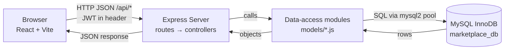

# High-Level Design (HLD) — Multi-Seller Marketplace Management System

## 1. Overview and Objectives

A small web marketplace where many independent **sellers** list products, **buyers** purchase them, and an **admin** supervises the platform. One buyer order can contain items from several sellers, so each order is split into **sub-orders** (one per seller) that sellers fulfil independently.

Objectives:

- Registration, login and role-based access (buyer / seller / admin).
- Browse products by category; seller-managed products, variants, prices and stock.
- Cart, wishlist, checkout and order placement with coupons.
- Per-seller order status management and simulated payment.
- Reviews for purchased products.
- A relational database that follows the supplied ER diagram, normalized to 3NF.

## 2. User Roles

| Role | Can do |
|---|---|
| Buyer | Browse, search, manage addresses, cart, wishlists, checkout, pay (simulated), view/cancel orders, write reviews |
| Seller | Register store (needs admin approval), manage products/variants/offers/stock, see and update own sub-orders |
| Admin | Approve/reject sellers, manage categories and coupons, view all orders and basic statistics |
| Delivery agent | **Database only** (tables + seed data + sample queries). No UI in this project. |

## 3. Functional Modules

| # | Module | Has UI? |
|---|---|---|
| 1 | Authentication and users (register, login, addresses) | Yes |
| 2 | Catalog (categories, products, variants, offers) | Yes |
| 3 | Seller inventory (create products, set price/stock) | Yes |
| 4 | Cart and wishlist | Yes |
| 5 | Checkout and orders (orders, sub-orders, order items) | Yes |
| 6 | Payment simulation | Yes (simple "Pay now" step) |
| 7 | Reviews | Yes |
| 8 | Admin (seller approval, categories, coupons, stats) | Yes |
| 9 | Shipment (auto-created when a seller marks a sub-order shipped) | Tracking number shown only |
| 10 | Delivery assignment, refund | **No** — in schema and seed data only |

**Database model vs. application:** all 22 ER entities are created in MySQL. Only modules 1–9 get working screens. Module 10 (delivery assignment, refund) is demonstrated with seed data and SQL queries.

## 4. Technology Stack

| Layer | Technology | Purpose |
|---|---|---|
| Frontend | React + Vite, `react-router-dom` | Pages, routing, forms |
| Backend | Node.js + Express.js, `mysql2`, `bcryptjs`, `jsonwebtoken`, `cors`, `dotenv` | REST API, authentication, business rules |
| Database | MySQL 8 (InnoDB) | Storage, constraints, transactions |
| Version control | Git + GitHub | Branches, pull requests |

No other libraries (no Redux, no ORM, no UI framework). Plain CSS and `fetch` are enough.

## 5. Architecture

**Flow of information**

1. A React page calls a function in `src/api/*.js` (a thin wrapper over `fetch`).
2. Express receives the request; middleware verifies the JWT and checks the role.
3. The controller validates input and applies business rules.
4. The controller calls a data-access (model) function, which runs parameterized SQL.
5. MySQL returns rows; the controller sends `{ success, data }` JSON back; React updates its state.

## 6. Major Workflows

**A. Registration and login**
Register (buyer or seller) → user row + role row (+ empty cart for buyers) → login → JWT returned → React stores it and redirects by role. Sellers stay `PENDING` until an admin approves.

**B. Seller lists a product**
Approved seller → create product (category, title) → add variants (size/colour/SKU) → add offer (price, stock) → product appears in public listing.

**C. Buying**
Browse → product detail → add offer to cart → (optional wishlist) → checkout: choose address, apply coupon, choose payment method → backend transaction creates order, one sub-order per seller, order items (price snapshot), reduces stock, creates payment, empties cart → pay (simulated).

**D. Fulfilment**
Seller sees own sub-orders → `CONFIRMED` → `SHIPPED` (shipment row with tracking number is created) → `DELIVERED`. When every sub-order of an order is delivered, the order becomes `DELIVERED`.

**E. Review**
Buyer with a delivered order item writes a rating (1–5) and comment for that product; it is marked as a verified purchase.

## 7. Scope and Limitations

In scope: everything marked "Yes" in section 3.

Out of scope / simplified:

- No real payment gateway; payment success/failure is simulated.
- No delivery-agent or refund screens (tables and sample data only).
- No image upload (products show a placeholder or a text URL).
- No email/OTP, password reset, or real-time notifications.
- Tax, shipping charges and seller commission are not calculated (`seller_payable` = sum of that seller's line totals).
- Single currency, single-region addresses, no pagination beyond a simple `LIMIT/OFFSET`.
- Derived attributes in the ER diagram (totals, ratings, line totals) are computed by SQL views/queries, not stored.
